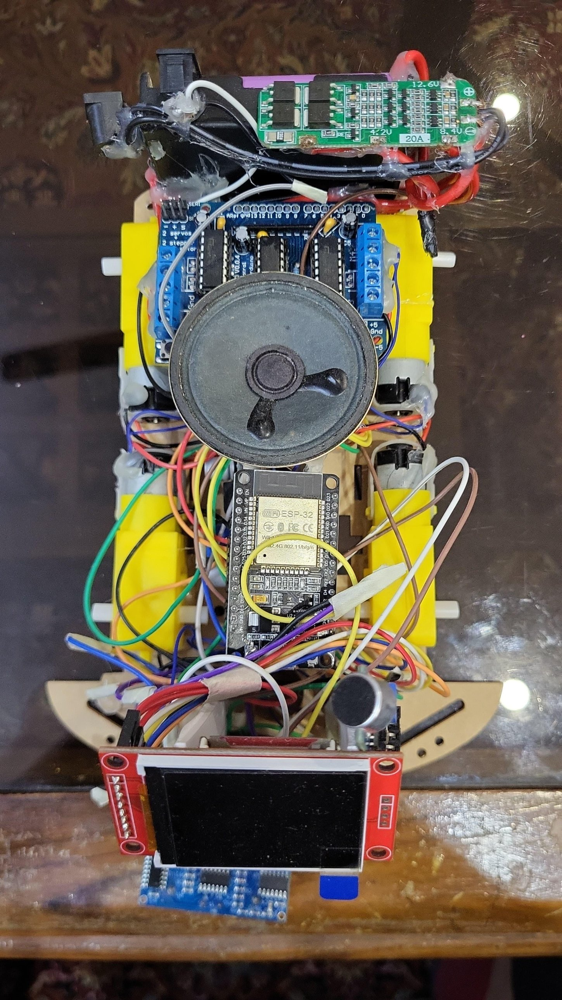
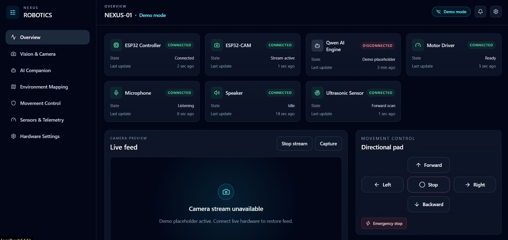
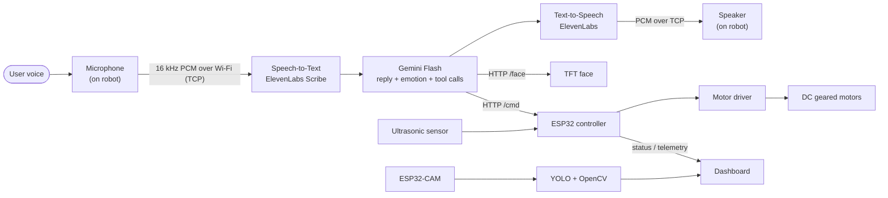

<div align="center">

# AI Companion Robot

**A voice-interactive, obstacle-aware companion robot: an ESP32 body, Gemini for conversation, ElevenLabs for speech, and YOLO + OpenCV for vision.**


<table>
  <tr>
    <td align="center" valign="middle">
      <br>
      <sub>The robot, top view</sub>
    </td>
    <td align="center" valign="middle">
      <br>
      <sub>Nexus Robotics dashboard (demo mode)</sub>
    </td>
  </tr>
</table>

</div>

---

## Overview

The AI Companion Robot combines artificial intelligence, computer vision, voice interaction and embedded systems in one wheeled platform. A person speaks to the robot, the robot answers aloud in natural speech, follows spoken movement commands, avoids obstacles, and shows its mood on a built-in screen.

The work is split by what each device does best. An **ESP32** handles real-time control: motors, sensors, the display and the robot's own microphone and speaker. A **laptop** handles the heavy AI work: speech recognition, **Google Gemini** for understanding and replies, **ElevenLabs** for speech synthesis, and **YOLO + OpenCV** for object detection. The two sides communicate over Wi-Fi.

## Key features

**Conversation**
- Voice interaction end to end: speech-to-text, Gemini for natural-language replies, text-to-speech.
- Audio goes through the robot's **own microphone and speaker**, streamed over Wi-Fi to the laptop.
- Half-duplex handling: the robot's microphone is muted while it speaks, so it never answers itself.
- Short movement commands ("go forward", "stop") run through a local **reflex layer**, so they work instantly without waiting for the LLM.
- The LLM can also trigger laptop actions through function calling: open a website, search the web, open an allowed app, tell the time, move the robot.

**Expressive display (ST7735 TFT)**
- Animated faces that match the reply: happy, laugh, love, sad, surprised, wink, cool, angry and neutral, plus listening and thinking states, with the mouth moving while the robot speaks.
- Idle screens that cycle every 5 seconds: clock and weather on a random wallpaper, a random retro emoji face, and a live sonar page showing the front distance.

**Movement and safety**
- Four-motor drive (forward, backward, left, right) through an L293D shield, controlled over a small HTTP API.
- Obstacle detection with an ultrasonic sensor: forward moves stop early when something is closer than 20 cm.
- **Idle patrol:** with no interaction, the robot makes one small move every 5 seconds (forward, backward, left, right, each followed by the opposite move) and scans the front distance every 3 seconds to hold its position within a small radius.
- Every move has an automatic stop timeout.

**Vision and monitoring**
- ESP32-CAM video stream with real-time object detection (YOLO + OpenCV).
- A web dashboard with device status, camera preview, a directional control pad and an emergency stop.

## System architecture



| Layer | Runs on | Responsibility |
|---|---|---|
| **AI processing** | Laptop (Python) | Speech-to-text, Gemini reasoning, text-to-speech, object detection, function calling |
| **Control** | ESP32 | Motor control, obstacle sensing, display, audio streaming, HTTP API |
| **Interface** | TFT screen, speaker, dashboard | Faces and status on the robot, monitoring and control from a browser |

## Hardware

| Component | Purpose |
|---|---|
| ESP32 DevKit V1 | Main controller (Wi-Fi, I2S audio, motor and display control) |
| HW-130 motor shield (2x L293D + 74HC595) | Drives four DC geared motors |
| 4x DC geared motors on a yellow chassis | Locomotion |
| HC-SR04 ultrasonic sensor | Front distance and obstacle detection |
| ST7735 1.8" TFT (160x128) | Faces, clock, weather, sonar page |
| ESP32-CAM | Camera stream for vision |
| INMP441 I2S MEMS microphone | Voice input |
| Speaker + HW-104 (PAM8403) amplifier | Voice output |
| 3S Li-ion pack with 20 A BMS | Main power |
| LM2596 buck converter | Stable 5 V logic rail |

### Pin map

**TFT display (ST7735, hardware SPI)**

| Signal | ESP32 pin |
|---|---|
| CS | D5 |
| SCK | D18 |
| MOSI (SDA) | D23 |
| DC | D2 |
| RESET | D15 |
| LED (backlight) | 5V |
| VCC | 3.3V |

**Motor shield (74HC595 + L293D)**

| Signal | ESP32 pin | Shield pad |
|---|---|---|
| SER (data) | D13 | 4 |
| CLK | D14 | 12 |
| LATCH | D27 | 7 |
| OE (active low) | D26 | 8 |
| M1 PWM | D25 | 11 |
| M2 PWM | D33 | 3 |
| M3 PWM | D32 | 5 |
| M4 PWM | D4 | 6 |

Motor power goes to the shield's `EXT_PWR` terminal (9-12 V). Logic 5 V and the shield's ground must be tied to the ESP32 ground. Leave the shield's `PWR` jumper off.

**Ultrasonic sensor (HC-SR04)**

| Signal | ESP32 pin |
|---|---|
| TRIG | D17 |
| ECHO | D16, through a 1 kΩ / 2 kΩ divider (5 V to 3.3 V) |
| VCC | 5V |

**Audio**

| Signal | ESP32 pin |
|---|---|
| INMP441 SCK / amp clock | D19 |
| INMP441 WS | D21 |
| INMP441 SD | D34 |
| Speaker signal out | D22 |

The INMP441 runs on **3.3 V** (not 5 V) with its L/R pin tied to GND. The speaker signal on D22 is a 1.024 MHz pulse stream, so it needs a two-stage RC filter before the amplifier:

```
D22 -> 1k -> node A (22 nF to GND) -> 1k -> node B (22 nF to GND) -> 1 uF -> amp "L" input
amp ground -> GND,  amp 5V + / - -> 5V rail,  speaker on "L OUT" + / -
```

Add a 470-1000 µF and a 100 nF capacitor across the amplifier's 5 V pins to reduce Wi-Fi-related ticking.

## Software stack

| Area | Technology |
|---|---|
| Firmware | Arduino C++ (ESP32 core), FreeRTOS task for audio, I2S, WebServer |
| Language (AI app) | Python 3.10+ |
| Conversation | Google Gemini Flash (model set with `GEMINI_MODEL`), function calling |
| Speech-to-text | ElevenLabs Scribe v2 |
| Text-to-speech | ElevenLabs Flash v2.5 |
| Vision | YOLO (Ultralytics) + OpenCV |
| Display | Adafruit GFX + Adafruit ST7735 libraries |
| Weather | Open-Meteo (no API key) |
| Dashboard | Browser-based Nexus Robotics dashboard |

## Repository structure

```
AiCompanionRobot/
├── firmware/
│   ├── robot_server/robot_server.ino    # main ESP32 firmware
│   ├── sonar_test/sonar_test.ino        # HC-SR04 check
│   ├── hello_test/                      # speaker check (clip stored in the sketch)
│   └── hello_test_single/               # same check as a single file
├── app/
│   ├── main.py                          # voice loop: listen -> think -> speak -> act
│   ├── brain.py                         # Gemini chat, tools, emotion tag parsing
│   ├── stt.py                           # speech-to-text
│   ├── tts.py                           # text-to-speech
│   ├── robot_audio.py                   # TCP audio link to the robot
│   ├── audio_test.py                    # mic + speaker echo test (no API keys)
│   ├── make_clip.py                     # builds the greeting clip for the speaker test
│   ├── requirements.txt
│   └── .env.example
├── dashboard/                           # Nexus Robotics web dashboard
├── docs/images/                         # robot-top-view.jpg, dashboard.jpg
└── README.md
```

## Getting started

### Prerequisites

- ESP32 DevKit V1 robot assembled and wired as in the [pin map](#pin-map)
- [Arduino IDE](https://www.arduino.cc/en/software) with the **esp32 by Espressif** board package
- Arduino libraries: **Adafruit GFX Library** and **Adafruit ST7735 and ST7789 Library**
- Python 3.10+ on a laptop connected to the **same 2.4 GHz Wi-Fi network** as the robot
- API keys for [Google Gemini](https://ai.google.dev/gemini-api/docs) and [ElevenLabs](https://elevenlabs.io)

### 1. Clone

```bash
git clone https://github.com/winterhell823/AiCompanionRobot.git
cd AiCompanionRobot
```

### 2. Flash the firmware

1. Open `firmware/robot_server/robot_server.ino` in the Arduino IDE.
2. Set your Wi-Fi name and password at the top of the file. **Never commit real credentials.**
3. Select **ESP32 Dev Module** (or *DOIT ESP32 DEVKIT V1*) and the correct port.
4. Upload with the 12 V motor supply off. If it stops at `Connecting......`, hold the **BOOT** button.
5. Open the Serial Monitor at 115200 baud and note the **IP address** it prints (it also appears on the TFT for a few seconds).

> If the build reports an I2S driver conflict, install the ESP32 board package **2.0.17**.

### 3. Set up the Python app

```bash
cd app
python -m venv venv
source venv/bin/activate          # Windows: venv\Scripts\activate
pip install -r requirements.txt
cp .env.example .env
```

Edit `.env`:

| Variable | Description |
|---|---|
| `ELEVENLABS_API_KEY` | ElevenLabs key (speech-to-text and text-to-speech) |
| `ELEVEN_VOICE_ID` | Voice to use for replies |
| `GEMINI_API_KEY` | Google Gemini key |
| `GEMINI_MODEL` | Gemini model name (for example `gemini-2.5-flash`) |
| `ESP32_IP` | The IP address printed by the robot |
| `AUDIO_SOURCE` | `robot` (default, uses the robot's mic and speaker) or `mac` (laptop mic and speaker, for testing) |
| `VAD_MIN` | Speech-detection threshold; raise it if noise triggers the robot, lower it if it misses your voice |

### 4. Run

```bash
python main.py
```

The robot connects, greets you with "Hello, how may I help you?", and starts listening.

## Usage

### Voice

| Say | What happens |
|---|---|
| "Go forward", "back", "left", "right", "stop" | Handled instantly by the reflex layer and sent to the motors |
| "Open YouTube", "search for ..." | Gemini calls a laptop tool |
| "What time is it?" | Gemini calls the time tool |
| "Tell me a joke", any question | Gemini replies in speech and the face shows a matching emotion |
| "Reset" | Clears the conversation memory |
| "Exit" | Shuts the robot's app down |

### Robot behaviour by state

| State | Screen | Movement |
|---|---|---|
| **Listening** | Listening face with sound waves | Still |
| **Thinking** | Thinking face | Still |
| **Speaking** | Emotion face with moving mouth | Still (microphone muted) |
| **Idle** (20 s without activity) | Clock and weather, random emoji, sonar page, 5 s each | Small patrol move every 5 s, distance scan every 3 s |

### ESP32 HTTP API

| Endpoint | Description |
|---|---|
| `GET /cmd?c=forward\|backward\|left\|right\|stop&ms=1500` | Move for `ms` milliseconds (100-5000) |
| `GET /face?s=happy&talk=1` | Show a face; `talk=1` animates the mouth |
| `GET /idle` | Return to the idle screens |
| `GET /status` | Front distance, home distance, drift and patrol state as JSON |
| TCP port `5005` | Bidirectional 16 kHz, 16-bit mono audio stream |

Face names: `happy`, `laugh`, `love`, `sad`, `surprised`, `wink`, `cool`, `angry`, `neutral`, `listening`, `thinking`.

## Hardware test utilities

Test each part on its own before running the full system.

| Utility | What it checks |
|---|---|
| `firmware/sonar_test` | Prints the HC-SR04 distance to the Serial Monitor |
| `firmware/hello_test` | Plays a spoken greeting through the speaker, with no laptop |
| `app/audio_test.py` | Records you through the robot's microphone and plays it back on the robot's speaker |

Open the Serial Monitor at 115200 baud while running the main firmware: it prints `[audio] mic peak=...` and `[sonar] front=... cm` lines that show whether the microphone and sensor are working.

## Dashboard

The Nexus Robotics dashboard (screenshot at the top) shows the state of every subsystem (ESP32 controller, ESP32-CAM, AI engine, motor driver, microphone, speaker, ultrasonic sensor), a live camera preview, and a directional pad with an emergency stop. Other sections cover vision, the AI companion, environment mapping, movement control, sensors and telemetry, and hardware settings.

It currently runs in demo mode with placeholder data. Live hardware integration is in progress.

```bash
cd dashboard
npm install
npm run dev        # http://localhost:5173
```

## Known limitations and roadmap

**Current limitations**
- Wi-Fi must be 2.4 GHz, and the laptop and robot must be on the same network.
- The speaker is driven without an I2S DAC (a filtered pulse stream into the HW-104 amplifier), so some background hiss is expected. A dedicated I2S amplifier such as the MAX98357A would give cleaner audio.
- Holding position during idle patrol needs an object within about 2 m in front. Backward moves are blind because there is no rear sensor.
- Gemini and ElevenLabs need an internet connection. Movement commands still work without Gemini.

**Roadmap**
- Autonomous navigation and environment mapping
- Facial recognition
- Richer conversation and longer-term memory
- Live hardware data in the dashboard

## Team

**Dr. Akhilesh Das Gupta Institute of Professional Studies, New Delhi** (affiliated to GGSIPU)

| Name |
|---|
| Nishtha Singh |
| Kratika Gupta |
| Yogita Kakkar |
| Vaibhav Sharma |

**Guided by:** Mr. Devraj Gautam, Assistant Professor

## References

1. Google, "Gemini API Documentation". https://ai.google.dev/gemini-api/docs
2. Ultralytics, "YOLO Documentation". https://docs.ultralytics.com/
3. OpenCV, "OpenCV Documentation". https://docs.opencv.org/
4. Espressif Systems, "ESP32 Technical Documentation". https://docs.espressif.com/projects/esp-idf/en/stable/esp32/
5. ElevenLabs, "API Documentation". https://elevenlabs.io/docs

## License

This project is released under the MIT License. See the `LICENSE` file for details.
